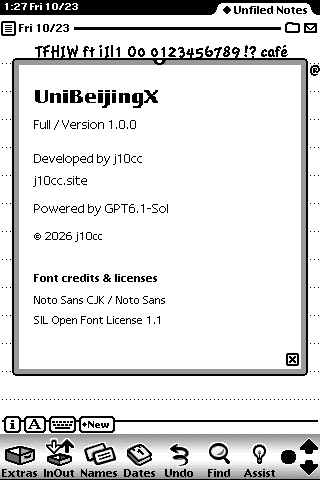
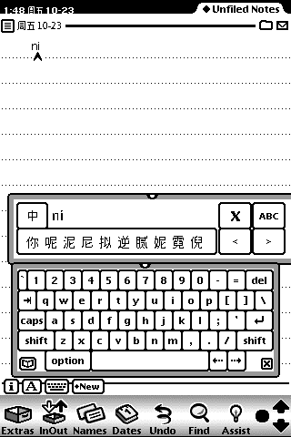
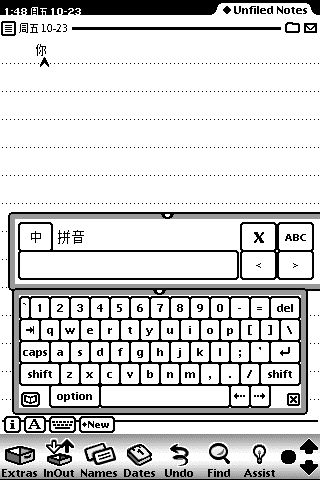
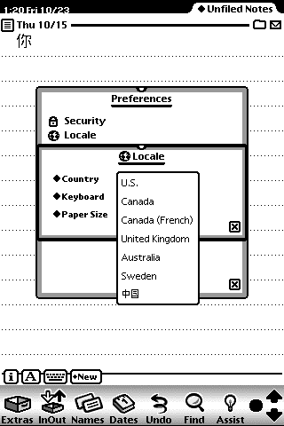

# UniBeijingX 1.0.0 使用手册

UniBeijingX 为 Apple MessagePad 2000／2100、Newton OS 2.1 提供简体中文显示、拼音输入和中文区域支持。作者：j10cc · [j10cc.site](https://j10cc.site)。

以下截图来自 Newton OS 2.1 模拟器，画面中的文字为操作示例。

## 1. 包的功能与选择

发布包包含四个安装文件。字体选择 Lite 或 Full 其中一个，输入法与区域包按需安装。

| 文件 | 功能 | 如何选择 |
| --- | --- | --- |
| Font-Lite.pkg | 中文字体、自动中文内容显示适配、About；内置 9／12／16 位图字号 | 较小的字体包；与 Full 二选一 |
| Font-Full.pkg | 与 Lite 相同的字符集和显示功能；内置 9／10／12／14／16／18 位图字号 | 需要更多原生字号时选择；与 Lite 二选一 |
| Pinyin.pkg | 拼音候选栏，配合 Newton 原生字母键盘输入汉字和词语 | 需要中文输入时安装 |
| ChineseRegion.pkg | 中文月份、星期、日期和时间格式、人民币、公制、A4，以及中国邮政地址查询辅助 | 需要中文区域设置时安装 |

两个字体包均提供 8,309 个映射字符，包含 GB2312 字符、部分扩展拉丁字母和符号。安装字体后，Notes、Names、Dates 等受支持界面中的中文内容自动使用中文字形；英文菜单、按钮及 City／State／Zip Code 等标签保持英文。

## 2. 安装

### 安装前准备

1. 备份 Newton 中的重要数据，并准备可向设备传送 `.pkg` 文件的安装工具；也可在已配置好的 Newton 模拟器中安装。
2. 解压 `UniBeijingX-1.0.0.zip`。目录内应有四个 `.pkg` 和本手册。
3. 保存当前编辑内容，关闭 Find、日期选择器、编辑表单和输入浮窗。

### 安装顺序

1. 安装 **Font-Lite.pkg 或 Font-Full.pkg**。两者使用相同包标识，不能同时安装。
2. 需要中文区域时，安装 **ChineseRegion.pkg**。
3. 需要拼音输入时，安装 **Pinyin.pkg**。
4. 在 **Extras → UniBeijingX** 打开 About，确认显示 **Version 1.0.0**，并核对 Lite／Full。
5. 安装区域包后，在 **Extras → Prefs → Locale → Country** 选择 **中国**。安装区域包本身不会自动替用户选择国家。

只需要阅读中文时，安装一个字体包即可。要输入中文，再安装 Pinyin；要使用中文日期、人民币和地址查询，再安装 ChineseRegion。

*安装后可打开 About 核对版本；图中为 Full。*

## 3. 使用

### 中文显示和字体

安装字体包后，受支持的文本、列表和日期显示会自动适配中文，无需为每个字段手工更改字体。需要主动设置字体时，在原生字体选择器中选择 **UniBeijingX**。Lite 与 Full 的字符范围相同，区别是内置位图字号数量。

### 拼音输入

1. 在文本字段中点选输入位置；从 **Extras → Pinyin IME** 打开候选栏。
2. 点候选栏右侧 **ABC**，调出 Newton 原生字母键盘。
3. 输入小写全拼，例如 `ni`，再点候选字“你”提交。
4. 空格选择当前页第一个候选；单字页最多 10 项，可用数字 **1–9、0** 选择；含词语的页面最多 7 项，可用 **1–7** 选择。
5. 用候选栏的翻页按钮查看更多候选；**中／英** 切换是否使用中文候选；**X** 关闭候选栏，之后可从 Extras 重新打开。

切换到另一字段后，先确认光标位置，再点一次 **ABC** 绑定新字段。

| 输入拼音并选择候选 | 提交汉字后 |
| --- | --- |
|  |  |

### 中文区域、日期和时间

在 Prefs 的 Country 中选择中国后，系统可使用中文月份、星期和日期时间格式、人民币显示，以及公制和 A4 设置。需要停止使用中文区域时，在同一位置选择其他国家。区域选择不设置时区；时区仍使用 Newton 自身的城市设置。

Names 的生日、纪念日文本字段支持 `2026-10-23` 和 `2026年十月23日` 等日期输入。Dates 中的日期行继续使用原生日期选择器。输入无效日期时，应检查并改正后再保存。

*从 Country 菜单选择“中国”，启用中文区域。*

### 中国地址与邮编

1. 启用中国区域，在 Names 中打开联系人的地址表单。
2. 将地址的 **Country** 填为 **China** 或 **中国**。
3. 从 **State → City → Zip Code** 依次选择省、市、区县和邮编；长列表使用 **Previous page／Next page** 翻页，也可手工填写。
4. 保存后重新打开，核对地址和邮编。

邮编按字符串保存，可保留前导零。数据来自中国邮政网点快照，使用前请核对实际投递地址。

## 4. 卸载与更换字体包

1. 保存数据，关闭 Find、日期选择器、编辑表单及 Pinyin 候选栏。
2. 按 **Pinyin IME → Chinese Region → UniBeijingX** 的顺序移除已安装的组件。
3. 更换 Lite／Full 时，移除当前字体包后先进行一次保留数据的正常重启，再按安装顺序安装所选包。

卸载组件不会主动删除已有中文记录；卸载字体后，英文 ROM 自身无法显示这些汉字。请避免在同一次开机会话中连续反复卸载、重装组件。

## 5. 已知问题与处理方法

### 错误 -10061：连续热装卸时的权限访问异常

**已知触发场景：**同一次开机会话内连续反复卸载、重装组件，尤其是在日期选择器、日期编辑或其他浮动窗口仍打开时，曾出现 `-10061`（Permission violation，权限访问异常），并导致部分区域日期方法无法正常访问。该问题尚未解决；目前确认的是上述触发场景，具体底层原因仍未查明。

**规避方法：**日常使用保持组件安装；需要移除或更换字体包时，先保存内容，关闭 Find、日期选择器、编辑表单和候选栏，按输入法、区域、字体的顺序卸载。再次安装前进行一次保留数据的正常重启，不要在多个活动窗口间连续反复热装卸。

**发生后：**停止继续装卸，保存仍可保存的内容，然后按设备的正常方式重新启动并保留原有数据；不要为此清除存储。模拟器应完全退出后使用原闪存重新启动。已有记录中，冷启动后日期功能及已保存数据恢复；这不表示故障已被修复。再次发生时，请记录错误码和触发前的操作。

### 其他限制

- **极快切换字段后的首键可能进入原字段。** 切换后确认光标，再点 ABC，稍候后输入。
- **部分字符仍可能显示方框。** 本包不覆盖全部 Unicode；两个字体版本的字符范围相同。请使用已覆盖字符，或改写超出字库范围的文字。
- **加载首帧可能短暂出现方框，部分“周”字底行可能裁切。** 等界面稳定后再阅读；必要时关闭并重新打开当前窗口。
- **很长的文件夹标题可能省略，超长地址可能响应较慢。** 使用较短名称；地址建议不超过 256 字符。
- **验证范围有限。** 本版已在 Newton OS 2.1 的隔离模拟器中验证；真实 MessagePad、实物打印及外部网络、传真、调制解调器和串口通信尚未完成验证。

## 6. 许可与来源

项目代码采用 Apache License 2.0，字体采用 SIL Open Font License 1.1，词库相关材料保留 MIT 许可。完整来源、版权和许可说明请参阅源码仓库根目录的 README.md、LICENSE 与 THIRD_PARTY_NOTICES.md。
